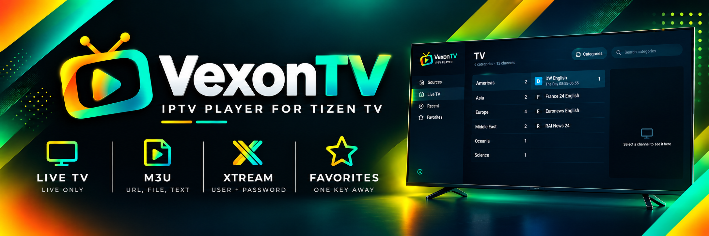

<p align="center">
  
</p>

<h1 align="center">VexonTV VOD</h1>

<p align="center">
  <strong>Live TV, movies and series for Samsung Tizen TVs.</strong><br>
  A fork of <a href="https://github.com/DvzZDev/VexonTV">DvzZDev/VexonTV</a> that keeps
  everything it does with live channels and adds the on-demand side it leaves out.
</p>

<p align="center">
  <a href="LICENSE"></a>
  
  
</p>

---

## 📑 What's in here

- [✨ What this fork adds](#-what-this-fork-adds)
- [📺 Using it](#-using-it)
- [🎮 The remote](#-the-remote)
- [📡 Sources](#-sources)
- [📲 Install on your TV](#-install-on-your-tv)
- [📝 Notes](#-notes)
- [🛠 For developers](#-for-developers)
- [📄 License](#-license)

---

## ✨ What this fork adds

Upstream VexonTV is live-only by design: it drops movies and series while it loads a
playlist. This fork keeps them and builds the rest of the app around all three.

- **A launch screen.** Live TV, Movies and Series as three large tiles, with Recent,
  Favorites and Sources underneath and the clock in the corner. There is no side menu: Back
  from any section returns here.
- **Movies.** A poster grid by category with sort (recently added, A–Z, rating), search,
  pages of 60, a details page with plot, cast and runtime, and Resume / Start over.
- **Series.** The same grid for shows; a show page with seasons beside episodes that opens
  on the episode to watch next; Up Next into the following episode, across seasons; and
  **Play random** for shows without a running story, which keeps shuffling through Up Next.
- **Continue watching.** Selected first in Movies and Series whenever it has something in
  it. Red on a poster, or a button on the details page, removes a title and forgets its
  progress.
- **A player for on-demand.** Scrub with the arrows and jump with OK, pause and the media
  keys, position saved every 15 seconds, English audio by default, an audio and subtitle
  picker, and subtitles drawn on screen. MKV files name their own tracks, so subtitles read
  "English (forced)" rather than "Track 3", and a forced English track comes on by itself.
- **Live TV changes.** It opens on the categories; UK categories come first; OK on a
  channel goes straight to full screen; Back returns to that channel; the panels' fake
  "#### CATEGORY ####" channels are hidden; and the in-player channel list has room for long
  category names.
- **The stream's quality** shows for a few seconds when a channel or title starts, for
  example "1080p · HEVC · 8.2 Mb/s".
- **Its own package ID**, so it installs beside the original instead of replacing it.

## 📺 Using it

| Screen           | What it does                                                                                                                                 |
| ---------------- | -------------------------------------------------------------------------------------------------------------------------------------------- |
| **Launch**       | Live TV, Movies or Series. Recent, Favorites and Sources below. Back here closes the app.                                                    |
| **Live TV**      | Categories on the left, channels in the middle, a preview on the right. Resting on a channel previews it; OK opens it full screen.         |
| **Movies**       | Categories, then posters. OK opens the details page: Play or Resume, Start over, Remove from Continue watching.                            |
| **Series**       | Categories, then shows. A show page lists seasons and episodes with progress and ticks; Play random sits beside Resume.                    |
| **Sources**      | Add, edit and remove playlists and portals. OK on a source opens Live TV with only its channels.                                            |

Movies and series are fetched the first time their section is opened, not at start-up:
panels often carry tens of thousands of titles.

## 🎮 The remote

**Live TV player**

| Key                 | What it does                               |
| ------------------- | ------------------------------------------ |
| `CH up` / `CH down` | change channel                             |
| `Left` or `OK`      | open the channel list; `Left` again for categories |
| `Down`              | the player menu (favorites)                |
| `Red`               | save or remove a favorite                  |
| numbers             | jump to that channel                       |
| `Back`              | close the list, then leave the player      |

**Movies and episodes**

| Key                     | What it does                                                        |
| ----------------------- | ------------------------------------------------------------------- |
| `Left` / `Right`        | move the scrub mark, 10 s a press, faster when held                 |
| `OK`                    | jump to the mark; with no mark, pause or play                       |
| `⏪` / `⏩`, `▶`, `⏸`, `■` | rewind, fast-forward, play, pause, stop                             |
| `Down`                  | audio and subtitle buttons                                          |
| `Back`                  | steps out: track list, mark, buttons, controls, then the player     |

**Browsing**

| Key    | What it does                                         |
| ------ | ---------------------------------------------------- |
| `Red`  | on a poster: remove it from Continue watching        |
| `Back` | details → grid → launch screen                       |

## 📡 Sources

| Source             | Live TV | Movies and series                                                                 |
| ------------------ | ------- | --------------------------------------------------------------------------------- |
| **Xtream Codes**   | ✅      | ✅ categories, ratings, covers, plot and cast, seasons and episodes               |
| **M3U / M3U8**     | ✅      | ✅ from `/movie/` and `/series/` addresses or video files; episodes from `S01E02`, `S01 E02` or `1x02` in the title |
| **Stalker portal** | ✅      | not yet                                                                           |

Add a source from **Sources → Add source**: an M3U link, the panel address with username and
password, a file from USB, or the provider's whole message pasted in.

## 📲 Install on your TV

This fork is not in the Apps2Samsung catalog (that installs upstream VexonTV), so it is built
and signed on your own computer.

**You need**

- The TV in Developer Mode with your computer's IP as the host. On the TV: Apps, type
  `12345`, switch Developer Mode on, enter the IP, restart the TV.
- [Tizen Studio](https://developer.samsung.com/smarttv/develop/getting-started/setting-up-sdk/installing-tv-sdk.html)
  CLI with the **TV Extensions** and **Samsung Certificate Extension** packages.
- A Samsung certificate profile that includes the TV's DUID. The TV only accepts apps
  signed with it.
- Python 3.

**Build, sign and install: one command**

Put the three settings in `.local/tv.json` (ignored by git), then deploy:

```json
{ "sdk": "~/tizen-studio", "profile": "<profile>", "target": "<tv-ip>:26101" }
```

```bash
python3 tools/tv.py deploy      # build, sign, install, launch
```

`build`, `install` and `launch` also run on their own. The script reconnects and retries when
the TV drops the connection mid-install.

**The same by hand**

```bash
python3 tools/build-wgt.py                                   # -> dist/VexonTV.wgt (unsigned)
mkdir -p dist/stage && cd dist/stage && unzip -o ../VexonTV.wgt && cd ../..
tizen package -t wgt -s <profile> -- "$PWD/dist/stage"       # signs it
mv "dist/stage/VexonTV VOD.wgt" dist/VexonVOD.wgt            # no spaces in the name
sdb connect <tv-ip>:26101
tizen install -n VexonVOD.wgt -s <tv-ip>:26101 -- "$PWD/dist"
tizen run -p vx7vod0fk2.VexonVOD -s <tv-ip>:26101
```

Tizen Studio's Java has to be on `PATH` for `tizen package`. If `tizen install` says no
target is connected, run `sdb connect` again and retry. Updates keep the same package ID, so
they install in place and keep sources, favorites and progress.

**Starting with your own source**

Put a `local-source.json` at the root of the repository and `tools/build-wgt.py` writes it
into the package, so a fresh install opens with it. Git ignores the file; it never goes into
a commit.

```json
{ "type": "xtream", "name": "My panel", "origin": "http://host", "user": "u", "pass": "p" }
```

## 📝 Notes

- **One stream per account.** Many panels allow one connection at a time. A movie that is
  refused once is retried after three seconds; if it fails again, stop playback on other
  devices and press Retry.
- **Subtitles.** The TV's player reports subtitle tracks without their language. The app
  reads names and languages from the start of MKV files; MP4 tracks may still show as
  "Track 1, Track 2".
- **Up Next** appears 45 seconds before an episode ends and plays the next one 15 seconds
  later, with the last 30 seconds of credits left.

### ✅ Tested on

| Device                                       | Platform  |
| -------------------------------------------- | --------- |
| Samsung Q60D QLED 55" (2024), `QE55Q60DAUXXU` | Tizen 9.0 |
| Samsung Q64D QLED 55" (2024), `TQ55Q64DAUXXC` | Tizen 8.0 (upstream VexonTV) |

## 🛠 For developers

```bash
pnpm install && pnpm test          # needs Node 20.19+, 22.13+ or 24+
python3 tools/build-wgt.py         # -> dist/VexonTV.wgt
```

Tests, file map and packaging: [docs/DEVELOPING.md](docs/DEVELOPING.md). The plan this fork
was built from, with the screen mockups: [docs/movies-series-spec.html](docs/movies-series-spec.html).

## 📄 License

[MIT](LICENSE), as upstream: copyright (c) 2026 DvzZDev, with this fork's changes under the
same terms. The launch-screen icons are Material Design icons (Apache License 2.0, Google).

Not affiliated with Samsung, the Tizen Project or the upstream author.
