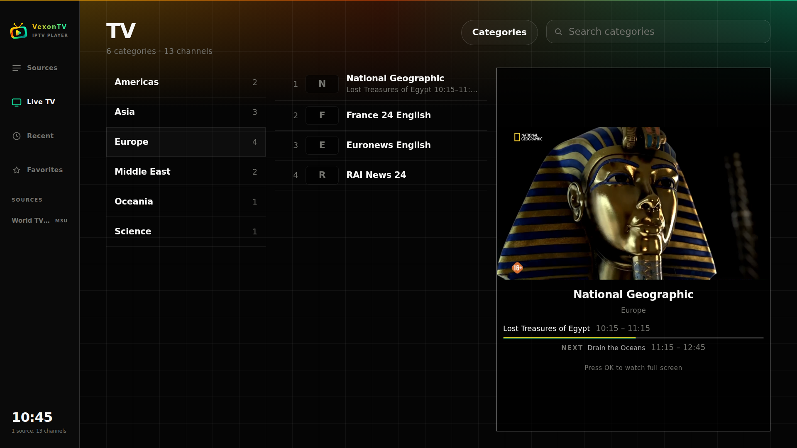
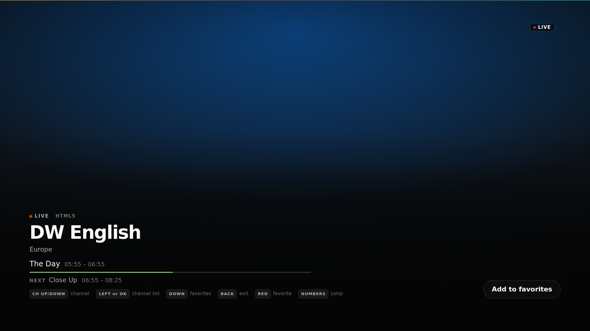
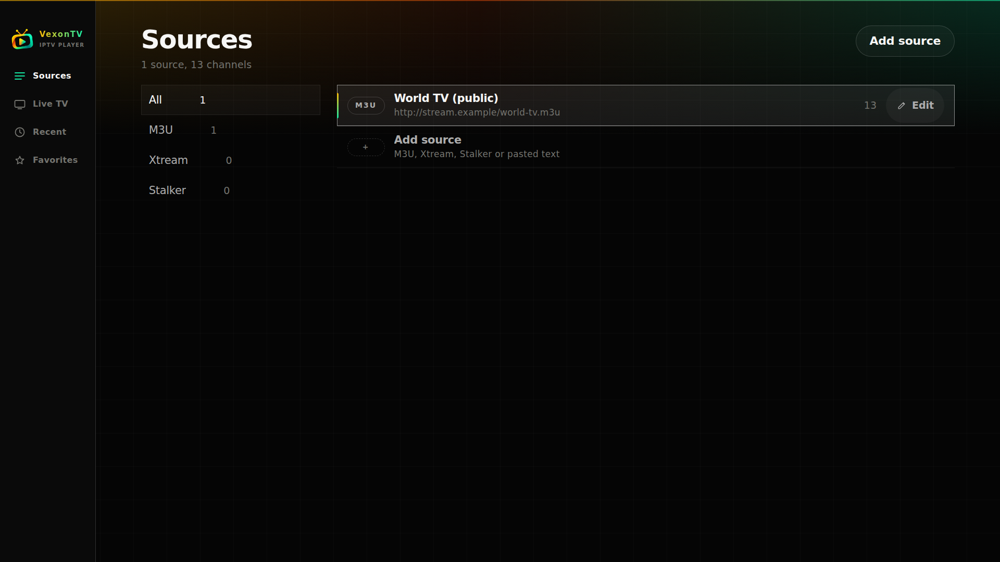
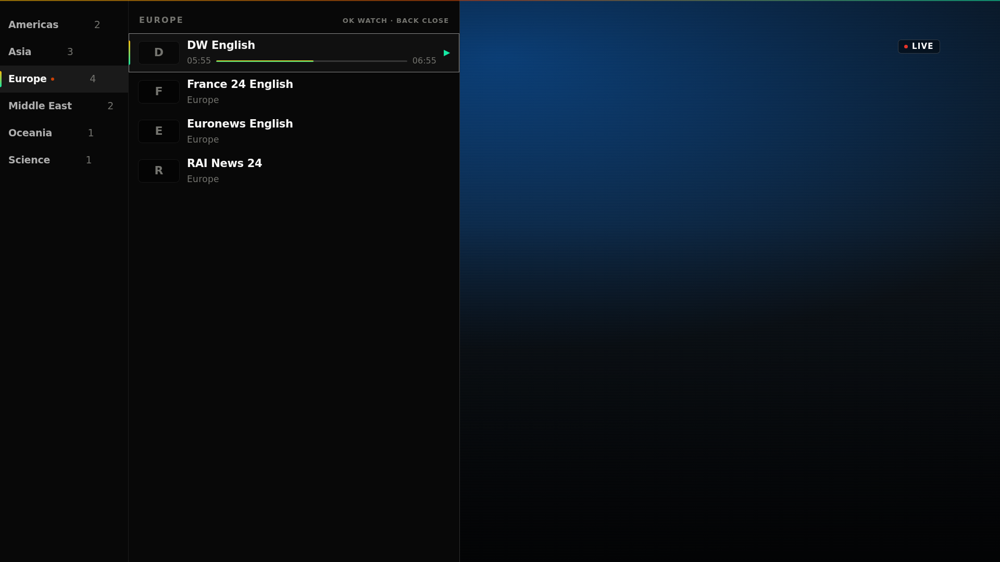

<p align="center">
  
</p>

<h1 align="center">VexonTV</h1>

<p align="center">
  <strong>A live TV player for Samsung Tizen TVs.</strong><br>
  M3U playlists, Xtream Codes and Stalker portals, provider EPG and a remote-first
  interface. No accounts, no ads.
</p>

<p align="center">
  <a href="LICENSE"></a>
</p>

---

## 📑 What's in here

- [📺 Install on your TV](#-install-on-your-tv)
- [✨ Why this exists](#-why-this-exists)
- [📡 What it plays](#-what-it-plays)
- [🖼 Screenshots](#-screenshots)
- [🎮 The remote](#-the-remote)
- [📝 Notes](#-notes)
- [📄 License](#-license)
- [🛠 For developers](#-for-developers)

---

## 📺 Install on your TV

A Samsung TV and a PC (or an Android phone) on the same network. About ten minutes, all of
it clicking: no terminal involved, and no SDK to install.

### 1. 🛠 The TV's developer mode, and your computer's IP

The TV hides that menu, and it asks for your computer's address, so have it ready first.

**Your computer's IP.**

- **On Windows:** Settings → _Network & Internet_ → your connection → _Properties_ →
  **IPv4 address**. It looks like `192.168.X.X` or `10.0.X.X`.
- **Or from a terminal,** if that is your thing: `ipconfig` on Windows, `ifconfig` or
  `ip addr` on Mac and Linux.
- **It has to be this computer's address, on the same network as the TV.** Cable and Wi-Fi
  give different addresses, and only the right one works.

**On the TV.**

- **Open the apps screen.** Press _Home_ or _Smart Hub_ on the remote, then go to **Apps**.
- **Type `12345`.** With that screen open, on the number pad. If your remote has no number
  buttons, press the **123** button and type it on screen.
- **Switch developer mode on.** Toggle _Developer mode_ to **On** and enter the IP you just
  found.
- **Restart the TV** from the power menu. The mode is not active until it reboots.

> [!TIP]
> If it still won't connect after the restart, unplug the TV from the wall, wait ten or
> fifteen seconds and plug it back in. That is what opens the port the installer needs.

> [!IMPORTANT]
> Ignore the SDK. Samsung's guides tell you to install Tizen Studio first: you do not need
> it, and Apps2Samsung signs and installs the app for you.

_Steps above adapted from the [Apps2Samsung wiki][devmode]. There is also a
[video walkthrough][devvideo] of the whole thing._

### 2. ⬇ Install Apps2Samsung

- **Download it** from its [releases page][a2s] — Windows, macOS, Linux or Android — and
  open it.
- **Only if you use a terminal:** `winget install --id Apps2Samsung.Apps2Samsung`.

### 3. 📲 Send VexonTV to the TV

- **Open Apps2Samsung.** It finds your TV on the network, or you type its IP.
- **Pick the Tizen Community catalog** and choose **VexonTV**.
- **Install.** The first time it will ask you to sign in with a Samsung account, once, to
  sign the app.
- **If it complains, believe it.** It tells you when developer mode is off, when the IP is
  wrong or reversed, and when the TV needs a restart.

### 4. 📋 Add your playlist

Open VexonTV and choose **Add source**. It takes an M3U link, the panel address with your
username and password, a file from a USB stick, or the whole message pasted in — it works
the format out by itself.

### 🚨 When it doesn't work

| What you see                       | What to do                                                                                                          |
| ---------------------------------- | ------------------------------------------------------------------------------------------------------------------- |
| No developer window                | You have to be _inside_ the apps screen. Try the numbers again, or the keypad.                                      |
| Developer mode switched itself off | Samsung expires it after a while. Redo step 1 and restart the TV.                                                   |
| Apps2Samsung can't find the TV     | Same network, and the IP on the TV has to be the computer's. If it still fails, allow Apps2Samsung in the firewall. |
| It installs but won't open         | Orsay TVs (before 2015) are not supported by anything here.                                                         |

## ✨ Why this exists

_I started looking for an IPTV player for my own TV and just could not find anything that really fit what I needed. The apps in Samsung's store were either weak or paid, and the free trials ran out within a week. On the community side I found Apps2Samsung, which works as the packaging tool most of these apps are built on, and tried a few of the community sub-apps made with it, but none of them fully convinced me. They had small bugs and interfaces I did not want to look at every night._

- **Live only.** Movies and series are filtered out on load, so what you browse is channels.
- **Smooth HD and 4K.** The TV decodes the channels itself, and the app never caps the
  resolution: whatever your TV can handle plays, without stutter.
- **Made for the remote.** Everything is reachable with the arrows and OK, and the player
  tells you what each key does.
- **Any panel.** M3U, Xtream Codes, Stalker, or paste anything and it works the format out.
- **Nothing in the middle.** No accounts, no ads, no server of ours: your playlists stay on
  your TV.

## 📡 What it plays

| Source             | What you give it                                                |
| ------------------ | --------------------------------------------------------------- |
| **M3U / M3U8**     | a URL, a file from USB, or the playlist text pasted in          |
| **Xtream Codes**   | panel address, username and password                            |
| **Stalker portal** | portal address and MAC                                          |
| **Detect**         | paste whatever your provider sent you; the format is worked out |

> [!NOTE]
> Stalker is implemented but not yet verified against a live portal: it needs a MAC from a
> provider.

## 🖼 Screenshots

| Live TV                                                                | Player                                           |
| ---------------------------------------------------------------------- | ------------------------------------------------ |
|  |  |

| Sources                              | Player channel list                                                   |
| ------------------------------------ | -------------------------------------------------------------- |
|  |  |

> [!NOTE]
> Captures of the interface itself, with demo channels: no provider of anyone's behind them.
> This is how the app looks before you add your own list.

## 🎮 The remote

| Key                 | What it does                             |
| ------------------- | ---------------------------------------- |
| `CH up` / `CH down` | change channel                           |
| `Left`              | unfold the channel list                  |
| `OK`                | pick a channel, press the focused button |
| `Down`              | the player menu (favorites)              |
| `Back`              | close the list, leave the player         |
| `Red`               | save or remove a favorite                |
| numbers             | jump to that channel                     |

## 📝 Notes

- **Live only, by design.** VOD and series are out of scope.

### ✅ Tested on

| Device                                                     | Platform                                                               |
| ---------------------------------------------------------- | ---------------------------------------------------------------------- |
| **Samsung Q64D QLED 55" 4K (2024)**, model `TQ55Q64DAUXXC` | Tizen 8.0, the platform these 2024 sets shipped with ([source][specs]) |

Browsing, inline preview, full screen playback, guide and favorites.

> [!WARNING]
> **Only Tizen 8.0 has been tested**, the platform of the TV above. Other Tizen versions may
> work, but backwards compatibility is not guaranteed.

## 📄 License

[MIT](LICENSE). Use it, fork it, ship it.

Not affiliated with Samsung or the Tizen Project.

## 🛠 For developers

```bash
pnpm install && pnpm test          # the test suites
python3 tools/build-wgt.py         # -> dist/VexonTV.wgt
```

Tests, file map and packaging: [docs/DEVELOPING.md](docs/DEVELOPING.md).
Before opening a pull request: [CONTRIBUTING.md](CONTRIBUTING.md).

[devvideo]: https://www.youtube.com/watch?v=F8kkdIh1TGY
[a2s]: https://github.com/Apps2Samsung/Apps2Samsung/releases
[devmode]: https://github.com/Apps2Samsung/Apps2Samsung/wiki/FAQ#-how-to-enable-developer-mode-on-your-tv
[specs]: https://developer.samsung.com/smarttv/develop/specifications/general-specifications.html
